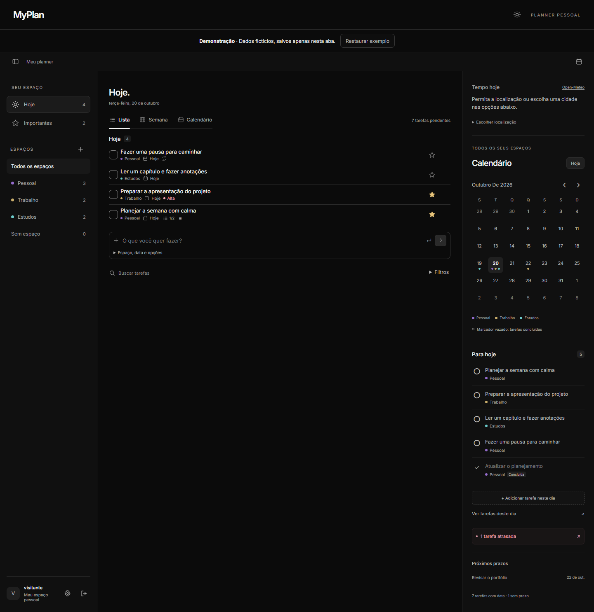
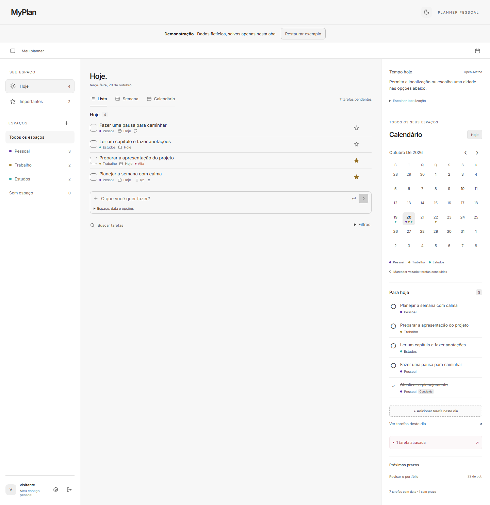
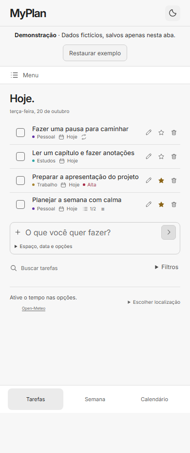
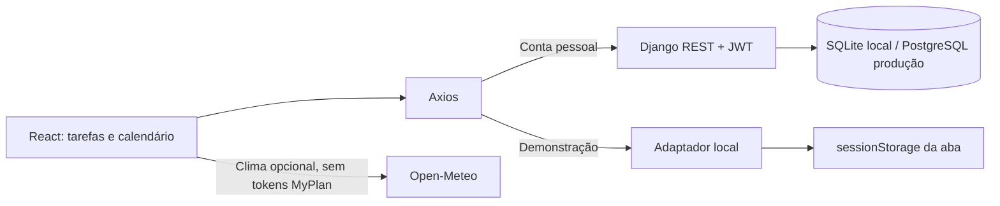

# MyPlan

**Seu dia, organizado.** Planner pessoal para reunir tarefas, checklists e prazos em um só lugar, com React e uma API Django REST Framework.

[](https://github.com/brunamedeirosz/MyPlan/actions/workflows/ci.yml)
[](LICENSE)



<details>
<summary>Ver modo claro e versão mobile</summary>





</details>

## Experimentar

O projeto inclui uma **demonstração sem cadastro** com dados fictícios. Na tela inicial, escolha **Experimentar demonstração**. Você pode editar tarefas, organizar espaços e explorar o calendário; as alterações ficam apenas na aba atual. **Restaurar exemplo** recomeça a demonstração e não altera nenhuma conta real.

Para experimentar localmente, basta Node.js 22.12+:

```sh
cd frontend
npm ci
npm run dev
```

Abra **http://localhost:5173/?demo=1**. No PowerShell, use `npm.cmd` se a execução de `npm.ps1` estiver bloqueada. A demo não precisa de Python ou banco de dados. A publicação no Pages usa o [workflow de demonstração](.github/workflows/demo.yml); o [guia de publicação](docs/publicacao.md) explica a configuração do repositório.

## O que o planner faz

- Cria, edita, conclui e reabre tarefas com descrição, prioridade e checklist.
- Organiza demandas em espaços pessoais, como Pessoal, Trabalho e Estudos.
- Mostra tarefas em lista, semana e calendário, com agenda diária de todos os espaços.
- Oferece busca, filtros, destaque de importantes e histórico de concluídas.
- Repete tarefas diariamente, semanalmente ou mensalmente ao concluir uma ocorrência.
- Permite desfazer a última exclusão e preserva rascunhos quando o salvamento falha.
- Adapta a navegação ao celular e oferece temas claro e escuro.
- Consulta o tempo pela localização autorizada ou por cidade escolhida manualmente.
- Na versão com servidor, persiste tarefas e espaços isolados por conta, com autenticação JWT.

## Decisões técnicas

| Área | Implementação |
| --- | --- |
| Interface | React 19, Vite e CSS; componentes compartilhados entre os modos com API e demonstração |
| API | Django 6, Django REST Framework e Simple JWT; validação e isolamento de dados no servidor |
| Datas | Prazos pessoais usam `DateField`, sem horário, para preservar o dia entre fusos |
| Recorrência | Conclusão e próxima ocorrência na mesma transação; vínculo impede duplicação ao reabrir |
| Sessão | Renovação de token compartilhada entre requisições; alterações de conta invalidam renovações pendentes |
| Persistência | SQLite no desenvolvimento e PostgreSQL no perfil de produção |
| Demonstração | Adaptador Axios local e `sessionStorage`; dados fictícios separados da sessão real |
| Publicação | GitHub Pages para demo; Docker, Gunicorn e WhiteNoise para a aplicação completa |
| Qualidade | Testes de API, regras de datas/filtros/demo, Playwright e pipelines para Linux e Windows |



A demo ilustra a experiência do produto. As regras definitivas, a autenticação e a proteção dos dados pertencem à API. Mais detalhes em [banco de dados](docs/banco-de-dados.md) e [requisitos](docs/requisitos.md).

## Executar com contas e banco

Pré-requisitos: Python 3.12 a 3.14 e Node.js 22.12+. O ambiente local foi validado com Python 3.14 e Node 24; a CI usa Python 3.13 e Node 24.

No Windows, a partir da raiz:

```powershell
cd backend
py -3.14 -m venv .venv
.\.venv\Scripts\python.exe -m pip install -r requirements.txt
.\.venv\Scripts\python.exe manage.py migrate
.\.venv\Scripts\python.exe manage.py runserver
```

No Linux/macOS:

```sh
cd backend
python3 -m venv .venv
.venv/bin/python -m pip install -r requirements.txt
.venv/bin/python manage.py migrate
.venv/bin/python manage.py runserver
```

Em outro terminal, na pasta `frontend`, execute `npm ci` e `npm run dev`. Abra **http://localhost:5173**, crie uma conta e adicione a primeira tarefa. Uma conta nova recebe três espaços e pode usá-los ou criar os próprios.

Os padrões locais dispensam PostgreSQL. Os dados ficam em `backend/db.sqlite3`, ignorado pelo Git. Para personalizar, copie `backend/.env.example` para `backend/.env` e `frontend/.env.example` para `frontend/.env`. Na interface, `VITE_API_URL` define a URL da API, incluindo `/api/`. As variáveis `VITE_*` são públicas no build; não coloque segredos nelas.

## Verificações

Na pasta `backend`, usando o Python da `.venv`:

```sh
python manage.py check
python manage.py makemigrations --check --dry-run
python manage.py test
```

Na pasta `frontend`:

```sh
npm run lint
npm test
npm run build
npx playwright install chromium
npm run test:e2e
```

O Playwright prepara e encerra os servidores de teste, usa portas 8001 e 5175 e um banco `backend/e2e.sqlite3` separado. O Python é descoberto na `.venv` do backend ou no PATH; `PLAYWRIGHT_PYTHON` permite escolher outro executável. `npm run test:demo` executa apenas os cenários da demonstração.

A CI verifica API com PostgreSQL, lint, testes, build e navegador no Linux; também executa os fluxos de navegador no Windows. A etapa Docker valida a configuração de produção e testa cadastro e persistência pela interface servida pelo container.

## Organização

```text
backend/core/          modelos, regras, API, migrações e testes
backend/config/        configurações local, e2e e produção
frontend/src/          interface atual e adaptador de demonstração
frontend/e2e/          fluxos de navegador e inicialização dos servidores
frontend/legacy/       interface anterior de equipes, fora do bundle atual
docs/                 arquitetura, imagens, requisitos e publicação
.github/workflows/    validações e publicação da demonstração
```

O projeto começou como DevDesk. O histórico e as migrações de equipes foram preservados; o produto atual é o planner pessoal MyPlan. As rotas de equipes ficam desativadas em produção. Veja a [delimitação do legado](frontend/legacy/README.md).

## Limites da V1

- Não há recuperação de senha por email, sincronização com calendários externos ou suporte offline completo.
- A próxima ocorrência nasce ao concluir a atual; não há agendamento em segundo plano.
- A interface carrega o histórico completo; paginação é uma evolução para volumes maiores.
- A demo não sincroniza dados entre abas ou aparelhos e não cria contas.
- A aplicação com contas exige hospedagem e PostgreSQL persistente; veja [publicação](docs/publicacao.md).

## Clima e licença

A previsão usa [Open-Meteo](https://open-meteo.com/), com geocodificação baseada no GeoNames. A localização depende da permissão do navegador; as coordenadas do dispositivo são arredondadas e ficam em memória. A busca manual funciona sem essa permissão. Tokens do MyPlan não acompanham essas requisições. A oferta gratuita do serviço tem [termos próprios](https://open-meteo.com/en/terms).

Código sob [licença MIT](LICENSE). A fonte Inter inclui sua licença OFL em `frontend/public/fonts/LICENSE.txt`. Histórico de versões em [CHANGELOG.md](CHANGELOG.md).
