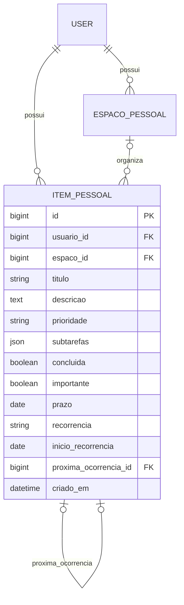

# Banco de dados — MyPlan

O domínio ativo é o planner pessoal. SQLite é o padrão local; o perfil
`config.production` exige PostgreSQL persistente. O diagrama abaixo representa
as entidades atuais; `der.png` é uma referência histórica do domínio de equipes.

## Histórico: domínio de equipes

Estas relações e suas migrações foram preservadas para manter os dados existentes.
Suas rotas ficam desativadas no perfil de produção do MyPlan.

- Usuário 1:N workspaces como gestor (`dono`).
- Workspace N:N usuários como colaboradores (`membros`).
- Workspace 1:N projetos.
- Projeto 1:N tarefas.
- Usuário 1:N tarefas como responsável (opcional).
- Tarefa 1:N comentários; cada comentário pertence a um autor.
- Usuário 1:N notas pessoais.

A V1 usa os membros do workspace como equipe de todos os projetos desse workspace.
Não há seleção independente de participantes por projeto. As permissões são aplicadas
na API tanto nas consultas quanto na criação e atualização das relações.

SQLite é o padrão local. PostgreSQL pode ser configurado pelas variáveis `DB_*`.
As migrações versionadas criam o esquema em ambos os bancos.

## Lista pessoal — foco atual

Usuário 1:N ItemPessoal. Cada item tem título, conclusão, destaque e data de criação.
Não há vínculo obrigatório com Workspace ou Projeto. A API `/api/itens-pessoais/`
filtra todas as operações pelo usuário autenticado. A migração 0009 cria essa tabela
sem remover ou transformar dados das funcionalidades de equipe.

## Espaços pessoais

Usuário 1:N EspacoPessoal; EspacoPessoal 1:N ItemPessoal. O espaço da tarefa é opcional.
Cada conta recebe Pessoal, Trabalho e Estudos no cadastro. A migração 0011 também
cria essas opções nas contas existentes e vincula seus itens antigos a Pessoal.
A exclusão de um espaço usa SET_NULL: os itens continuam disponíveis em Sem espaço.
Excluir todas as opções é permitido; a API não recria opções em consultas ou login.
A API valida que o espaço de uma tarefa pertence ao mesmo usuário autenticado.

## Calendário das tarefas

ItemPessoal.prazo é um DateField opcional, introduzido na migração 0012.
A API recebe YYYY-MM-DD ou null, sem conversão para UTC. A interface monta o calendário
a partir das tarefas de todos os espaços, mesmo com a lista filtrada; não há tabela separada de eventos externos.

## Descrição, checklist, prioridade e recorrência

A migração 0013 adiciona campos compatíveis ao ItemPessoal: descricao (texto), prioridade
(baixa/media/alta), subtarefas (lista JSON validada, no máximo 50 entradas), recorrencia
(nenhuma/diaria/semanal/mensal), inicio_recorrencia (âncora interna) e proxima_ocorrencia
(relação interna de uma ocorrência com a próxima). Tarefas existentes recebem valores
padrão e continuam com os mesmos ids, datas, espaços e estados de conclusão.

A conclusão e a geração da próxima ocorrência acontecem na mesma transação. A relação
interna impede que reabrir e concluir uma ocorrência novamente crie outra próxima tarefa
quando uma já existe. Nenhum usuário pode definir essa relação pela API.
